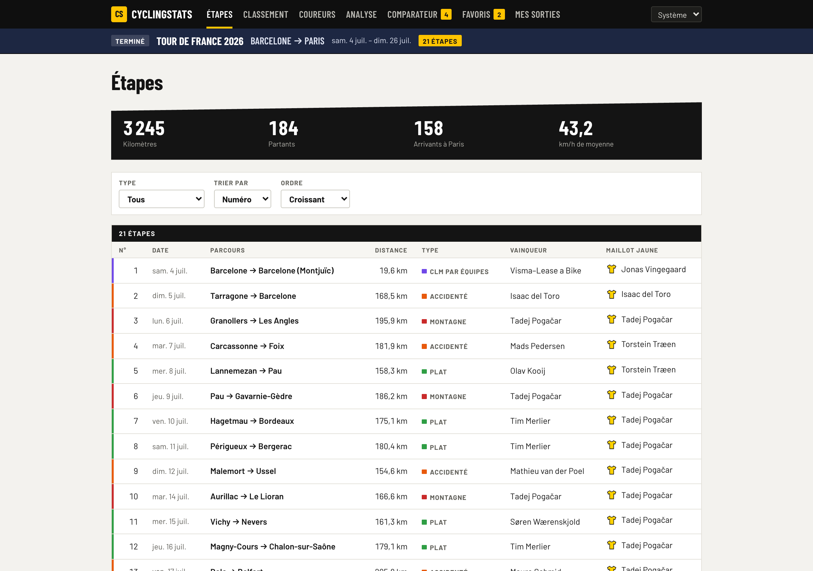
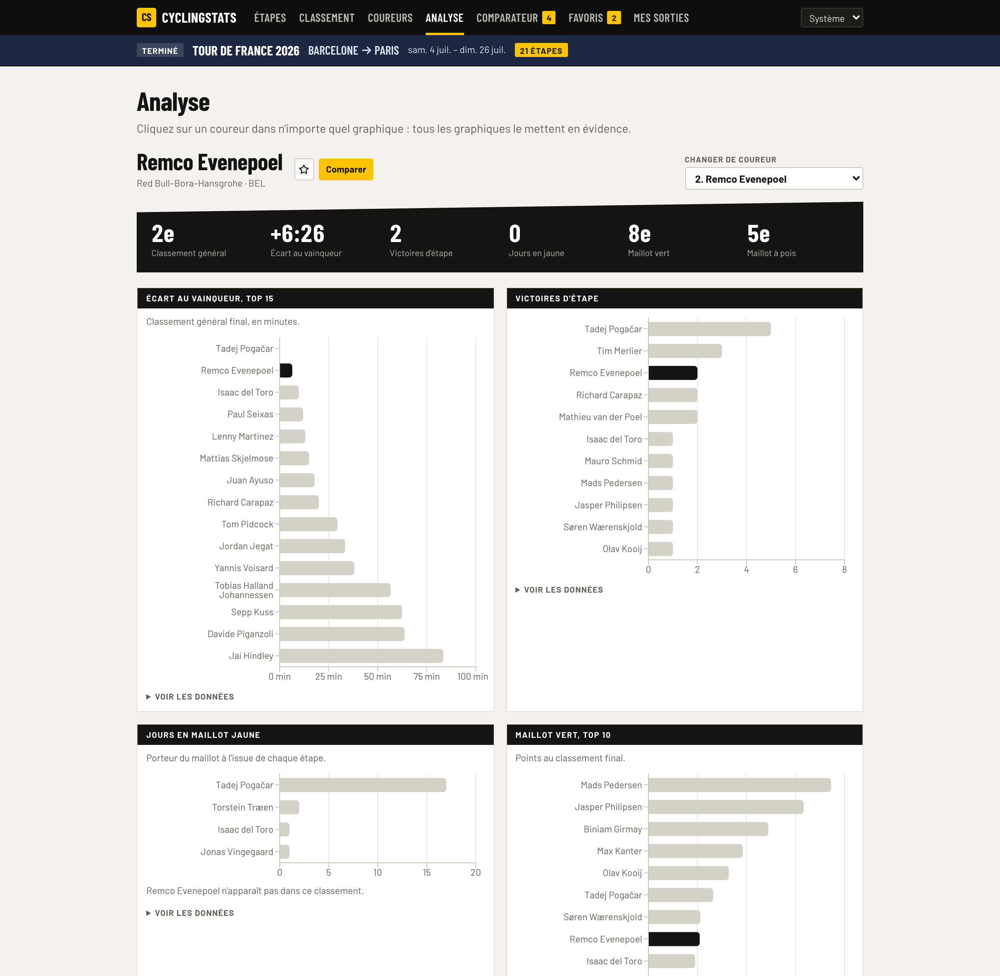
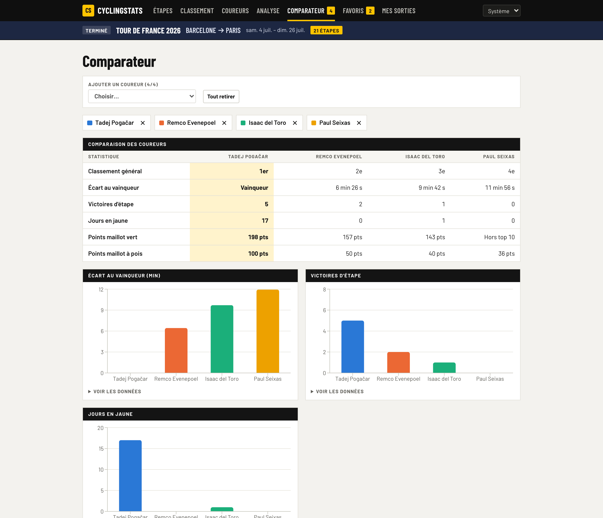
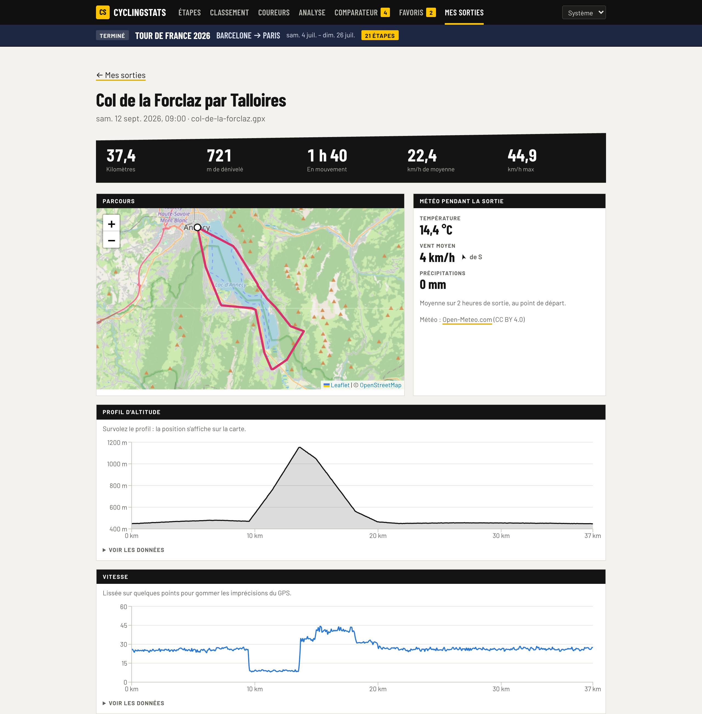
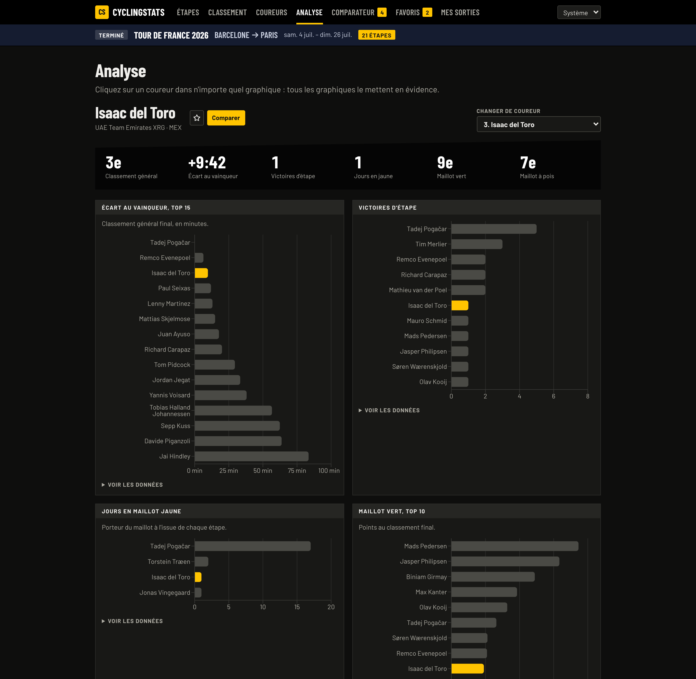
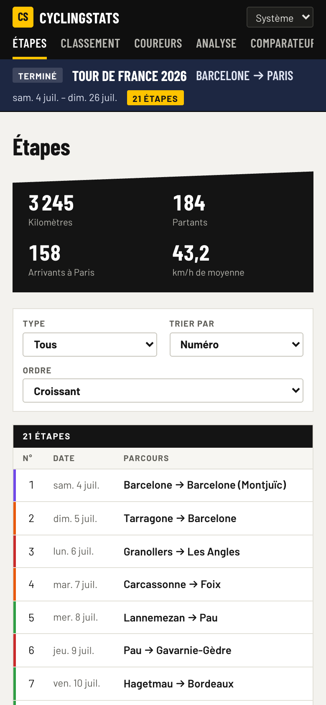

# Cyclingstats

Tableau de bord du **Tour de France 2026** et de **mes propres sorties vélo**, 100 % front-end.
Projet de portfolio qui montre trois compétences : **consommation d'API**, **gestion d'état** et
**interface complexe**.



> **Démo en ligne** : à venir.

## Ce que fait l'application

- **Étapes** : les 21 étapes, filtrables par type et triables. Chaque étape a sa fiche, avec la
  météo réelle à l'arrivée le jour de la course.
- **Classement général** : les 158 arrivants, avec recherche par nom (sans tenir compte des
  accents), filtres par équipe et nationalité, tri et pagination.
- **Coureurs** : recherche et pagination faites par l'API, favoris et ajout au comparateur.
- **Analyse** : cinq graphiques liés. Cliquer sur un coureur dans l'un d'eux le met en évidence
  dans tous les autres.
- **Comparateur** : de 2 à 4 coureurs côte à côte, chacun avec une couleur fixe.
- **Mes sorties** : import de fichiers GPX ou FIT, ou de l'archive complète exportée de Garmin
  Connect, lus dans le navigateur. Carte, profil d'altitude et vitesse synchronisés, météo
  pendant la sortie, statistiques par mois, et « Ma sortie vs le Tour ».
- Thème clair, sombre ou système. Filtres dans l'URL : chaque vue se partage par lien.

| Analyse à graphiques liés | Comparateur |
|---|---|
|  |  |

| Une sortie GPX | Thème sombre | Mobile |
|---|---|---|
|  |  |  |

## Stack

| Rôle | Outil |
|---|---|
| Interface | React 19, TypeScript en mode strict, Vite |
| Navigation | React Router |
| État serveur | TanStack Query |
| État de l'interface | Zustand (préférences dans `localStorage`, sorties dans IndexedDB) |
| Fichiers d'activité | fit-file-parser (FIT), fflate (zip) |
| Fausse API | MSW (Mock Service Worker) |
| Graphiques | Recharts |
| Carte | Leaflet et OpenStreetMap |
| Tests | Vitest, Testing Library, axe-core |

## Choix techniques

- **Trois sortes d'état, chacune à sa place.** Les données de l'API vivent dans le cache de
  TanStack Query. Les filtres, le tri, la page et le coureur sélectionné vivent dans l'URL. Les
  favoris, les coureurs comparés, le thème et les sorties importées vivent dans Zustand. Rien
  n'est copié d'un endroit à l'autre.
- **Une vraie couche API.** Les composants ne font jamais de `fetch` : ils passent par des hooks
  typés (`src/api/`) qui gèrent le cache, l'annulation des requêtes quand un filtre change, la
  pagination avec l'en-tête `X-Total-Count` et les erreurs (pas de nouvel essai sur une 404).
- **Deux façons de filtrer, volontairement.** Le classement général est filtré dans le navigateur
  (158 lignes, jointes avec les coureurs et les équipes). La page Coureurs fait filtrer et paginer
  l'API.
- **Requêtes dépendantes.** La météo d'une étape enchaîne deux appels Open-Meteo : on trouve
  d'abord les coordonnées de la ville d'arrivée, puis on charge la météo du jour de la course.
- **Fichiers d'activité lus dans le navigateur.** GPX avec `DOMParser`, FIT avec une bibliothèque
  MIT. L'archive Garmin est fouillée jusque dans ses zip imbriqués ; les autres sports, le home
  trainer et les doublons (même départ à une minute près, quel que soit le format) sont
  écartés. Distances par la formule de haversine, dénivelé lissé avec un seuil pour ignorer le
  bruit de l'altimètre, temps en mouvement. Aucun fichier n'est envoyé sur un serveur.
- **Pas de synchronisation Garmin automatique.** Elle demanderait un serveur (connexion OAuth,
  réception des nouvelles activités) et l'accès à l'API officielle, réservé aux développeurs
  acceptés par Garmin. Le SDK FIT officiel n'est pas utilisé : sa licence interdit de le
  redistribuer, ce que ferait une appli web publique.
- **Chargement à la demande.** Seule la page Étapes est dans le bundle initial. Recharts, Leaflet
  et le code GPX ne se chargent qu'avec les pages qui en ont besoin ; le lecteur FIT et la
  décompression zip, seulement au premier import qui en a besoin.
- **Vite plutôt que Next.js.** L'application n'a pas de serveur, un site statique suffit.

## Données et sources

- **Résultats du Tour : une API simulée.** Les données viennent d'un jeu figé, préparé une fois
  par un script Python (`data-prep/build_db.py`) à partir de
  [Wikipedia](https://en.wikipedia.org/wiki/2026_Tour_de_France), recoupé avec OA Sport et
  CyclingUpToDate. MSW les sert dans le navigateur comme une vraie API REST. Limites connues :
  pas de classement après chaque étape, podiums d'étape partiels (voir `data-prep/README.md`).
- **Météo** : [Open-Meteo](https://open-meteo.com/) (API réelle, sans clé, licence CC BY 4.0).
- **Carte** : © [contributeurs OpenStreetMap](https://www.openstreetmap.org/copyright).
- **Sorties de démonstration** : un échantillon de mes vraies sorties, publié avec le site
  (`public/demo/rides.json`) pour que la page Mes sorties ne soit pas vide. Le départ et
  l'arrivée de chaque trace sont masqués sur 500 m. Voir « Mettre à jour la démo ».
- **Sorties d'exemple générées** : trois traces **générées** autour du lac d'Annecy
  (`data-prep/make_sample_gpx.py`), utilisées par les tests, pas de vraies sorties.
- Pas d'API Strava : son accès développeur est devenu payant.

## Lancer le projet

```bash
npm install
npm run dev          # http://localhost:5173
```

| Commande | Effet |
|---|---|
| `npx vitest run` | tests (une fois) ; `npm test` pour le mode surveillance |
| `npm run typecheck` | vérification des types |
| `npm run lint` | linter (oxlint) |
| `npm run build` | build de production dans `dist/` |
| `python3 data-prep/build_db.py` | régénère le jeu de données du Tour |
| `node scripts/screenshots.mjs` | refait les captures du README (appli lancée, Chrome installé) |

## Mettre à jour la démo

Les sorties importées restent dans le navigateur de chaque visiteur. Pour que la démo en ligne
montre des données, un échantillon est publié avec le site :

1. Lancer l'appli en local (`npm run dev`) et, sur Mes sorties, ne garder que les 10 à 20
   sorties à montrer (« Tout supprimer » puis importer celles choisies).
2. Cliquer sur **Exporter la démo**. Ce bouton n'existe qu'en développement. Le fichier
   `rides.json` téléchargé contient les sorties avec le départ et l'arrivée masqués sur 500 m.
3. Le placer dans `public/demo/rides.json`, commiter, redéployer.

Un visiteur sans sorties reçoit la démo, signalée par un bandeau. Dès qu'il importe ses propres
fichiers, ils remplacent la démo chez lui. Un nouvel export remplace l'ancienne démo chez les
visiteurs qui l'avaient encore.

## Tests

69 tests dans 16 fichiers :

- **Fonctions pures** : lecture des filtres depuis l'URL, filtrage du classement, calcul des
  statistiques par coureur, lecture d'un GPX et d'un FIT (fichiers FIT fabriqués par les tests),
  archive Garmin avec zip imbriqués, doublons entre formats, dénivelé, regroupement par mois ou
  par an, récap face au Tour, masquage du départ et de l'arrivée, synthèse météo.
- **Stores** : favoris, plafond de 4 coureurs comparés, couleur conservée quand on en retire un ;
  démo remplacée au premier import et qui ne revient pas une fois retirée.
- **Composants**, avec la même fausse API servie dans Node par MSW : filtres écrits dans l'URL,
  erreur puis « Réessayer », recherche avec debounce, pagination par l'API, page 404,
  enchaînement géocodage puis météo, import GPX et rejet des doublons, démo puis remplacement
  par les imports du visiteur, récap qui compte toutes les sorties, bascule mois / an.
- **Accessibilité** : axe-core sur les pages Étapes et Classement.

## Accessibilité

Navigation complète au clavier, lien « Aller au contenu », focus replacé sur le contenu à chaque
changement de page, titre d'onglet propre à chaque page. Tableaux avec légendes et en-têtes,
états annoncés aux lecteurs d'écran (`aria-pressed`, `aria-live`, `aria-busy`, `role="alert"`).
Chaque graphique a sa vue en tableau. La couleur n'est jamais le seul indice, et les animations
sont coupées si le système le demande. Toutes les pages passent axe-core sans erreur, en thème
clair comme en thème sombre.

## Ce que j'ai appris

> À réécrire avec tes propres mots. Pistes tirées de ce qui a réellement posé question :

- Séparer l'état serveur, l'état d'URL et l'état d'interface plutôt que de tout mettre dans un
  store global.
- Concevoir des clés de requête TanStack Query qui partagent le cache entre les écrans.
- Mettre les filtres dans l'URL sans boucle entre la saisie et la recherche avec debounce.
- Garder les couleurs d'un graphique attachées à l'entité et pas à son rang.
- Calculer un dénivelé fiable malgré le bruit de l'altimètre.
- Tester des composants avec la même fausse API que dans le navigateur.

## Limites et pistes

- Classement général après chaque étape : à récupérer avec un vrai scraping, par exemple un
  back-end Node ou Python avec PostgreSQL et un cache.
- Pas de validation des réponses d'API à l'exécution (Zod serait une bonne étape suivante).
- Les barres des graphiques ne sont pas focalisables au clavier. Le choix d'un coureur reste
  possible par le menu déroulant.
